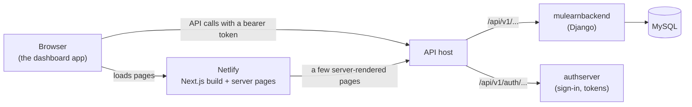

# Overview

## Summary

The μLearn dashboard (`mulearn-dashboard`) is one Next.js app that learners, campus leads, mentors, companies and the μLearn team use to work with the μLearn backend. It is large: 1,545 TypeScript files, 48 feature folders and 134 pages.

This folder sets the dashboard's target shape and the plan to get there:
- **The shape:** one app with strict feature modules ([ADR-001](adr/ADR-001-one-app-strict-feature-modules.md)). Each feature exposes one public surface, rules are checked in CI, and every backend change the dashboard must follow has one home.
- **The plan:** the first 12 weeks as issues anyone can pick up ([github-issues/](github-issues/README.md)). Each issue says which backend issue it waits for, if any.

It is the companion of the backend's architecture ([backend docs](https://github.com/gtech-mulearn/mulearnbackend/blob/dev/docs/architecture/README.md)). The two use the same phase names, so a dashboard issue can sit in the same phase as the backend work it follows.

## Why this exists

1. **The backend is changing what the dashboard talks to.** Responses gain a stable error `code` and a `requestId`. Production moves behind nginx with request time limits and an upload size limit. Later, authorization moves off the roles in the token, and page sizes get capped. The dashboard needs to know what changes, where in its code, and when.
2. **The dashboard has its own structural problems.**
   - Its tests don't run in CI.
   - Feature folders reach into each other's internals 156 times.
   - Page access is decided from token claims the dashboard decodes but can't verify; the backend still checks every data call.
   - Contributors have no written target.

## The system in one picture

Most work happens in the browser, which calls the API host directly. The host sends `/api/v1/auth/...` to the authserver and everything else to the backend. A few server-rendered pages call the backend from the server.

## Principles

- **Understand before changing.** Every claim about today's code cites a file at `dev` 6d6cb30b.
- **The backend is the source of truth for capability.** A dashboard change that uses a backend change waits for it, and names the backend issue.
- **No big-bang.** Work moves one feature, one pull request at a time.
- **Never break against the deployed backend.** Reading new fields needs no gate. Sending anything new is gated per environment ([ADR-011](adr/ADR-011-flags-for-new-sends.md)).
- **Rules are automated.** A rule without a check decays ([ADR-003](adr/ADR-003-import-ratchets.md), [ADR-012](adr/ADR-012-tests-in-ci-with-a-baseline.md)).
- **Users hold several roles at once.** Every access decision considers all of them.

## The options that were compared

| Option | Trade-off |
|---|---|
| **One app with strict feature modules** (chosen) | The smallest change from today; it maps one-to-one onto the backend's issues. Token storage stays a recorded decision to revisit |
| Bring back a server-side proxy | Safer token handling and server-side checks, but it reverses the earlier removal of the proxy, adds a hop and cost to every call, and changes every feature's data code |
| Micro-frontends | Dropped: too much deployment and shared-state complexity for one team's app |

The full record is [ADR-001](adr/ADR-001-one-app-strict-feature-modules.md).

## What happens when

| Phase | Dashboard work |
|---|---|
| 0 Stabilise and secure | Tests in CI with a failure baseline; line-ending policy; the cycle check; setup docs |
| 1 Foundations | The deep-import check; the first features cleaned up; the API client ready for `code` and `requestId`; query-key conventions |
| 2 Serving and runtime | Timeouts, temporary 503s, the upload limit and 429, released before the backend's nginx move; error boundaries; error reporting; bundle budgets; one token refresh across tabs; page sizes capped |
| 3 Schema safety net and events | The backend change tracker kept current; no dashboard μCoin work for now |
| 4 Contributions and the ledger | Nothing the dashboard must change: the backend keeps its routes and responses |
| 5 and later | Epics: page access from the backend's grants, gamification, notifications, privacy, API standards, the design system |

Week-by-week detail is in [14-roadmap.md](14-roadmap.md).

## Recommendations

1. **Land the Phase 0 issues first.** Every later issue relies on tests running in CI. Turn on private vulnerability reporting (issue 0040) before filing any of the issues.
2. **Release the time-limit handling to each environment before the backend's nginx move reaches it:** timeouts, temporary 503s, the upload limit and 429 (issues 0022, 0042 and 0043). Staging needs the release before backend 0045 deploys there (week 7), and production before backend 0047's cutover (issue 0044). Merging isn't enough.
3. **Treat every new request field or header as a two-step change:** build it behind a flag, then turn the flag on per environment.
4. **Decide the backend gaps listed in [06-backend-contract.md](06-backend-contract.md#the-change-tracker):**
   - an endpoint for the caller's grants;
   - CORS for new request headers, and for reading `X-Request-Id`, `Retry-After`, `ETag`, `Deprecation` and `Sunset`;
   - the fast-failing auth routes the load tests expect.
