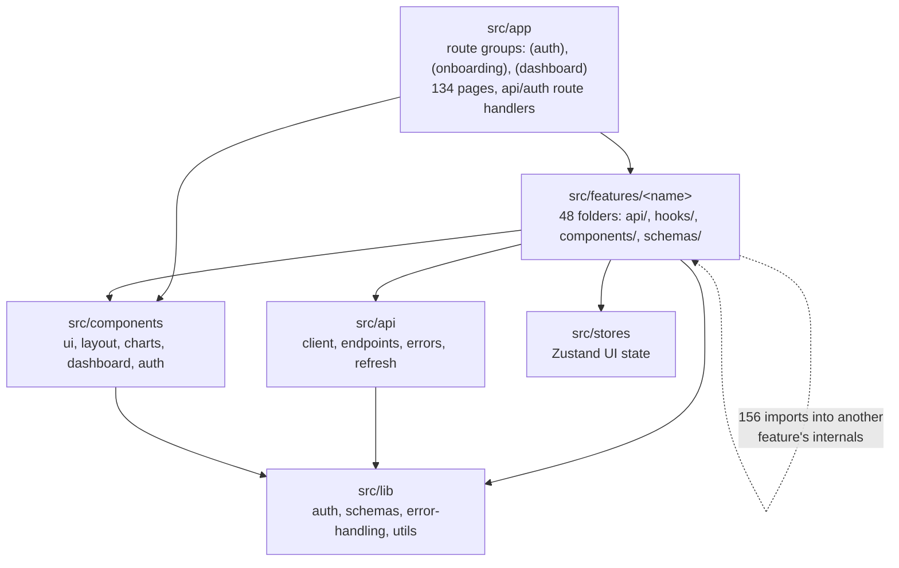
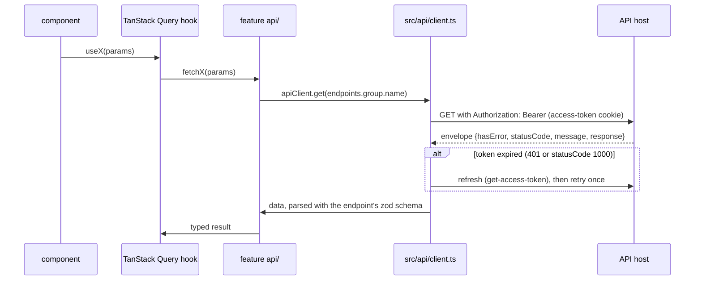

# Current state

Describes `dev` at 6d6cb30b (17 Nov 2026).

## The app in one paragraph

`mulearn-dashboard` (version 5.4.1) is one Next.js app on the App Router, with React 19, TanStack Query for server data, Zustand for a little UI state, zod for parsing responses, and Biome for linting. It has 1,545 TypeScript files under `src/`, 48 feature folders and 134 pages. 622 files are client components (`"use client"`): most of the work happens in the browser, which calls the backend directly with a bearer token. It deploys to Netlify through GitHub Actions and promotes `dev` → `staging` → `master`.

## How the code is organised

- **Routes** live in `src/app/`, in three route groups: `(auth)`, `(onboarding)` and `(dashboard)`. Two route handlers, `src/app/api/auth/logout/` and `src/app/api/auth/refresh/`, handle server-side token work.
- **Features** live in `src/features/<name>/`. Most follow one layout: `api/` (endpoint calls with zod schemas), `hooks/` (TanStack Query hooks), `components/`, and `schemas/`, `types/` or `utils/` as needed. 45 of the 48 have an `index.ts`; `college-levels`, `company-mentors` and `push` don't.
- **Shared code** lives in `src/components/` (components, with `src/components/ui` as the base set), `src/lib/` (auth, schemas, helpers), `src/hooks/` and `src/stores/`.
- **The API layer** is `src/api/`. `src/api/endpoints.ts` (1,768 lines) holds every backend path in one `endpoints` object of named groups.

## How a request flows

- **`src/api/client.ts`** provides `publicApiClient` (no token), `apiClient` (token, one refresh and retry on expiry, redirect to sign-in on failure) and `authedFetch` (raw fetch with the same refresh; 4 multipart uploads use it). Most uploads, 12 calls, send `FormData` through `apiClient` with `isFormData: true`.
- **Responses are parsed with zod.** A mismatch is logged with `logSchemaMismatch` (`src/api/errors.ts`), in development only, and errors are turned into messages with `extractDjangoMessage`.
- **Server-side calls.** 9 pages call `requireAuth` and 43 call `requireRole` (`src/lib/auth/server.ts`), which read the user on the server before rendering. When a page loads with an expired token, the refresh route (`src/app/api/auth/refresh/route.ts`) refreshes on the server through `src/api/refresh.server.ts`, and sets the new cookie.
- **Token paths.** The dashboard calls `/api/v1/auth/user-authentication/`, `/api/v1/auth/get-access-token/` and `/api/v1/auth/logout/`, among others in `endpoints.auth`. The API host routes `/api/v1/auth/...` to the authserver.

## Auth and page access today

- **Tokens.** After sign-in, `src/lib/auth/token-store.ts` keeps the access token (15 minutes) and the refresh token (7 days) in cookies set from JavaScript, with `sameSite: "lax"` and `secure` in production. Server-side code sets some of the same cookies differently: `src/api/server.ts` re-sets the access cookie as `httpOnly` after a server-side refresh, and `src/app/api/auth/refresh/route.ts` sets it without. The decision and its trade-offs are in [ADR-008](adr/ADR-008-token-storage.md).
- **Page access** decides which pages render, not who can see data. The backend checks every data request. It is decided in layers, each from the token's role claims: `src/proxy.ts` checks the route map in `src/lib/auth/route-access.ts`; 43 server pages call `requireRole` (`src/lib/auth/server.ts`); and components use `RoleGate` and the `PERMISSIONS` map (`src/lib/auth/permissions.ts`). Role values come from `src/lib/auth/roles.ts` (22 roles, plus per-interest-group lead roles). Navigation uses `src/hooks/use-filtered-nav.ts`, and components check permissions with `src/hooks/use-permissions.ts`. Users hold several roles, and access is the union of all of them. The target is in [08-auth-and-access.md](08-auth-and-access.md).
- **Refresh.** Inside one tab, concurrent refreshes share one promise (`inFlight` in `src/api/refresh.client.ts`). Across tabs, each refreshes on its own.

## State

Server data lives in TanStack Query: 139 files use its hooks. Most features keep their keys in a factory in `hooks/query-keys.ts` (37 such files, for example `eventKeys`), but 92 inline key arrays remain in 26 files, 40 of them in invalidations, and 12 features have no factory. Zustand holds two UI stores: `src/stores/ui-store.ts` and `src/stores/company-banner-store.ts`.

## Testing, CI and releases today

- **Tests.** 115 test files (`*.test.ts(x)`) run with Vitest (`vitest.config.ts`), but `package.json` has no `test` script, and CI doesn't run them.
- **CI** (`.github/workflows/ci.yml`) runs `bun run lint`, `bun run typecheck` and `bun run build` on pull requests to `dev`, `staging` and `master`.
- **Other checks.** `changeset-check.yml` requires a changeset on pull requests to `dev` and `staging`. `bun run lint:circular` (madge) checks import cycles, but CI doesn't run it.
- **Releases.** `release.yml` versions and tags `master` with changesets.
- **Deployment.** `staging-deploy.yml` builds `staging` in GitHub Actions and deploys it to Netlify, passing only the two `NEXT_PUBLIC_*` variables to the build. `docs/DEPLOYMENT.md` describes the staging and production sites and which variables are set where. How production and `dev` are deployed is to verify ([10-build-and-deployment.md](10-build-and-deployment.md)).

## Findings and technical debt

| # | Finding | Evidence at 6d6cb30b | Effect | Addressed by |
|---|---|---|---|---|
| T-01 | Tests don't run in CI | 115 test files, no `test` script, CI runs lint, typecheck and build only | Regressions merge unnoticed | [ADR-012](adr/ADR-012-tests-in-ci-with-a-baseline.md) |
| T-02 | Features reach into each other | 156 imports into another feature's internals, 9 of them relative; `company-jobs` 53, `mentor` 27 | A change in one feature breaks others | [ADR-002](adr/ADR-002-feature-anatomy-and-public-surface.md), [ADR-003](adr/ADR-003-import-ratchets.md) |
| T-03 | Three features have no public surface | `college-levels`, `company-mentors`, `push` lack `index.ts` | Everything they hold is importable | [ADR-002](adr/ADR-002-feature-anatomy-and-public-surface.md) |
| T-04 | Import cycles go unchecked | `lint:circular` exists but isn't in CI | Cycles grow | [ADR-003](adr/ADR-003-import-ratchets.md) |
| T-05 | One very large endpoints file | `src/api/endpoints.ts`, 1,768 lines | Every feature's change touches one shared file | [05-data-fetching-and-state.md](05-data-fetching-and-state.md) |
| T-06 | Query keys aren't always from the factory | 92 inline key arrays in 26 files, 40 of them in invalidations; 12 features without a factory | An invalidation misses a key, and stale data shows after edits | [ADR-004](adr/ADR-004-server-state-and-ui-state.md) |
| T-07 | Tabs refresh tokens independently | `src/api/refresh.client.ts` shares a refresh within a tab, not across tabs | Duplicate calls today; sign-outs once refresh tokens rotate | [ADR-010](adr/ADR-010-single-flight-refresh.md) |
| T-08 | No error reporting | no reporting service installed | Failures are seen only when users report them | [ADR-014](adr/ADR-014-observability.md) |
| T-09 | Some pages ask for very large pages of results | 6 call sites request more than 100 rows, up to 1,000 | They will break when the backend caps page sizes | [06-backend-contract.md](06-backend-contract.md) |
| T-10 | No line-ending policy | no `.gitattributes` | Lint results differ between Windows and other systems | [12-testing-and-quality-gates.md](12-testing-and-quality-gates.md) |
| T-11 | Deployment isn't fully described in the repo | only staging deploys from a workflow | Contributors can't tell what runs where | [10-build-and-deployment.md](10-build-and-deployment.md) |
| T-12 | Token cookies are set in more than one way | `token-store.ts`, `src/api/server.ts` and the refresh route set different cookie options for the same tokens | Behaviour depends on which path refreshed last | [ADR-008](adr/ADR-008-token-storage.md) |
