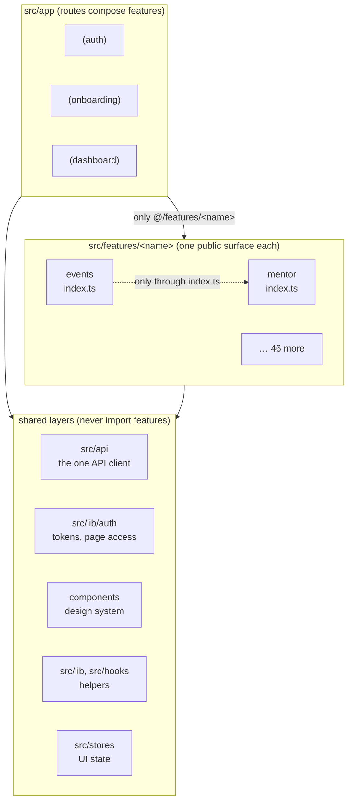
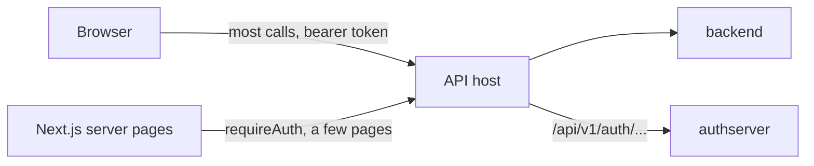

# Target architecture

The target is **one app with strict feature modules** ([ADR-001](adr/ADR-001-one-app-strict-feature-modules.md)). Nothing on this page exists yet unless it says so. Today's state is in [02-current-state.md](02-current-state.md).

## The shape

- **Routes** in `src/app/` compose pages from features and shared components. They hold no endpoint calls of their own.
- **Features** in `src/features/<name>/` each own their endpoint calls, response schemas, query hooks and components. Their `index.ts` is the only thing other code may import ([ADR-002](adr/ADR-002-feature-anatomy-and-public-surface.md)).
- **Shared layers** sit below features and never import them:
  - `src/api`: the one API client and its error model ([ADR-006](adr/ADR-006-one-api-client-and-error-model.md));
  - `src/lib/auth`: tokens, refresh and page access ([08-auth-and-access.md](08-auth-and-access.md));
  - the design system: `src/components/ui` today, and the new `src/components/design-system/` folder once it lands ([07-ui-and-design-system.md](07-ui-and-design-system.md));
  - `src/lib` and `src/hooks`: framework-light helpers;
  - `src/stores`: UI-only state ([ADR-004](adr/ADR-004-server-state-and-ui-state.md)).

## Modules

A **module** groups the feature folders that work with one backend module, so a backend change points to one place. The catalogue is in [modules/README.md](modules/README.md) ([ADR-016](adr/ADR-016-module-docs-follow-backend-catalogue.md)):
- **17 module pages mirror backend modules.** They are `contributions`, `gamification`, `identity_access`, `people`, `organizations`, `communities`, `learning`, `rewards`, `events`, `mentorship`, `careers`, `interns`, `media`, `projects`, `notifications`, `integrations` and `administration`.
- **6 pages cover shared code:** the app shell, the API client, auth and access, the design system, the shared library, and the workspace features (home, onboarding, search, settings, tour).

A module is a documentation and labelling unit, not a new folder. The code stays in `src/features/<name>/`.

## What talks to what

- **The browser keeps calling the backend directly** ([ADR-007](adr/ADR-007-browser-calls-backend-directly.md)).
- **Server-rendered pages** call it from the server only where rendering needs the data.
- **Token routes go to the authserver** through the same host. Changes on that side are maintainer work in the authserver.

## Rules that hold everywhere

1. **One way in to a feature:** `@/features/<name>`. A check in CI counts the exceptions, which only go down ([ADR-003](adr/ADR-003-import-ratchets.md)).
2. **Server data lives in TanStack Query,** with every key from the feature's factory, and UI state in Zustand ([ADR-004](adr/ADR-004-server-state-and-ui-state.md)).
3. **Every response is parsed with zod** where it enters the app ([ADR-005](adr/ADR-005-parse-at-the-boundary.md)).
4. **Every failure becomes one `ApiError`,** carrying the backend's `code` and `requestId` when present ([ADR-006](adr/ADR-006-one-api-client-and-error-model.md)).
5. **Reading new backend fields needs no gate; sending anything new does** ([ADR-011](adr/ADR-011-flags-for-new-sends.md)).
6. **Page access considers every role a user holds,** and is a convenience, not security ([ADR-009](adr/ADR-009-page-access.md)).
7. **Tests run in CI,** and only new failures fail the build ([ADR-012](adr/ADR-012-tests-in-ci-with-a-baseline.md)).

## Today and the target, side by side

| Area | Today (6d6cb30b) | Target |
|---|---|---|
| Feature boundaries | 156 imports into other features' internals | Only `index.ts` imports, checked in CI |
| Tests | Not run in CI | Run on every pull request, behind a baseline |
| Errors | One `ApiError` with a message from `extractDjangoMessage`; about 100 files build their own toast text | `ApiError` also carries `code`, `requestId` and field errors; error states and toasts show the request id |
| Query keys | Factories in most features; 92 inline key arrays left, 40 of them in invalidations | Every key from the feature's factory, checked in CI |
| Page access | Token roles, checked in layers: the route map, `requireRole`, `RoleGate` | The backend's grants, once an endpoint exposes them |
| Token refresh | Per tab | One refresh across tabs |
| Error reporting | None | Browser errors reported with request ids |
| Large lists | Up to 1,000 rows per request | At most 100 rows per request, paged |
| Design | `src/components/ui` | The design system, once approved |
