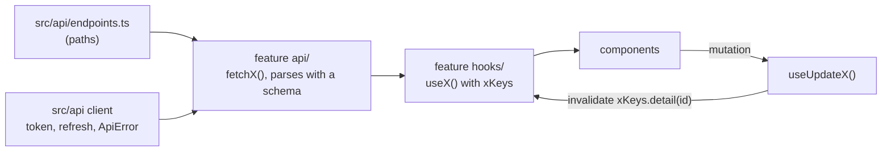

# Data fetching and state

How data moves from the backend to the screen, where it is kept, and how it stays fresh. Facts about today describe `dev` at 6d6cb30b; the decisions are [ADR-004](adr/ADR-004-server-state-and-ui-state.md) and [ADR-005](adr/ADR-005-parse-at-the-boundary.md).

## The path of a piece of data



1. **The path** of an endpoint lives in `src/api/endpoints.ts` today. Over time each feature's paths move into its `api/paths.ts`, one feature per pull request. Paths other features also use stay in `src/api/endpoints.ts`.
2. **A feature's `api/` function** calls the endpoint through the shared client (`src/api`), and parses the response with a zod schema from the feature's `schemas/`.
3. **A hook in `hooks/`** wraps the call in TanStack Query, with a key from the feature's key factory.
4. **Components** read the hook. They never fetch on their own.

## The query client

Today's defaults are set in `src/app/providers.tsx`:
- results count as fresh for 60 seconds;
- queries don't refetch when the window regains focus;
- failed queries retry up to 3 times, except on a 4xx response.

The target keeps these defaults, with one change from [11-reliability-and-observability.md](11-reliability-and-observability.md): a request the backend cut off at its time limit is retried at most once.

## Query keys

**Today** most features keep their keys in a factory in `hooks/query-keys.ts` (37 such files). But 92 inline key arrays remain in 26 files, 40 of them in invalidations, and 12 features have no factory.

**Target:** every key comes from the feature's factory, as `events` already does:

```ts
export const eventKeys = {
  all: ["events"] as const,
  lists: () => [...eventKeys.all, "list"] as const,
  list: (params: EventListQueryParams, authenticated = true) =>
    [...eventKeys.lists(), authenticated ? "auth" : "public", params] as const,
};
```

- Every query in the feature uses the factory. A CI check stops new inline keys, against a shrink-only list of today's.
- A mutation invalidates the narrowest keys it changed, for example `eventKeys.detail(id)` and the `eventKeys.lists()` prefix, never the whole cache.
- Another feature that shows the same data invalidates through the owning feature's public surface.

## Parsing responses

- **Every response is parsed with zod** where it enters the app. On a mismatch, `logSchemaMismatch` (`src/api/errors.ts`) logs the endpoint and the failing path. Today it logs only in development, so drift on staging or production goes unseen; the error-reporting issue sends mismatches to the error logger, sampled, without values.
- **New optional backend fields** are added to schemas as `.optional()`, so the dashboard works against both old and new backends.
- **The backend's envelope** is `{hasError, statusCode, message, response}`. The backend will add `code` and `requestId` (backend issue 0019), which the client will read into `ApiError` ([06-backend-contract.md](06-backend-contract.md)).
- **Later, types are generated** from the backend's OpenAPI spec once it is published in CI. The zod schemas are then checked against those types.

## Lists and paging

- Pages request **at most 100 rows** and page through the rest. Six call sites ask for more today, up to 1,000, and the backend plans to cap page sizes ([06-backend-contract.md](06-backend-contract.md#the-change-tracker)).
- Long lists use `useInfiniteQuery` or explicit paging; 5 files use infinite queries today.
- Large exports become backend jobs in the backend's Phase 8. Until then, an export page states its row limit.

## Server-rendered data

A few pages load data on the server: 9 pages call `requireAuth` and 43 call `requireRole` (`src/lib/auth/server.ts`). The rule:
- server rendering is used where a page needs its data before first paint;
- the same `api/` function and schema are used on both sides, so there is one parser per endpoint.

## UI state

- **Zustand stores** in `src/stores/` hold UI state only: open panels, banners, preferences. Today there are two: `ui-store.ts` and `company-banner-store.ts`.
- **Server data is never copied** into a store or into component state. Read it from the query instead.

## Loading, empty and error states

- Use the shared `StateDisplay` component (`src/components/ui/state-display.tsx`) for empty and no-results states, and the error fallbacks in `src/components/ui/errors/` for errors: `SectionErrorFallback` for a section, `InlineErrorFallback` inside a component, `GlobalErrorFallback` for the whole app.
- Error states show the message from `ApiError`, and its request id when there is one.
- A loading state never blocks the whole page when only one section is loading.
