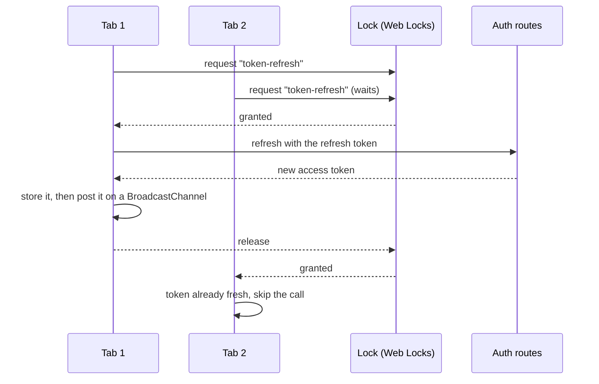

# Auth and access

How the dashboard signs users in, keeps their session, and decides which pages to show. Facts about today describe `dev` at 6d6cb30b. The decisions are [ADR-008](adr/ADR-008-token-storage.md), [ADR-009](adr/ADR-009-page-access.md) and [ADR-010](adr/ADR-010-single-flight-refresh.md); the backend's side is its auth page ([backend auth and permissions](https://github.com/gtech-mulearn/mulearnbackend/blob/dev/docs/architecture/08-auth-and-permissions.md)).

**The backend decides who can see and change data, on every request.** Everything on this page is about the browser's side: holding the session and showing the right pages. None of it is a security boundary.

## Signing in

- Sign-in, OTP, Google sign-in and token routes are under `/api/v1/auth/...` (`endpoints.auth` in `src/api/endpoints.ts`). The API host routes them to the authserver in every environment; the backend itself proxies some of them.
- Server-side changes to sign-in, refresh or logout are maintainer work in the authserver, which is a private repository. Dashboard issues cover only the dashboard's side.

## Tokens

**Today:**
- After sign-in, `src/lib/auth/token-store.ts` keeps the access token (15 minutes) and the refresh token (7 days) in cookies set from JavaScript, with `sameSite: "lax"` (deliberate: OAuth returns need it) and `secure` in production.
- Server-side code sets the access cookie with different options: `httpOnly` for 24 hours after a server-side refresh in `src/api/server.ts`, readable for 15 minutes in `src/app/api/auth/refresh/route.ts`.

**Target** ([ADR-008](adr/ADR-008-token-storage.md)):
- **One helper sets every token cookie,** with the same lifetime and flags on every path.
- **Keep untrusted script off the page.** Cookies set from JavaScript are readable by any script on the page, so content is never inserted as raw HTML, and markdown is sanitised. A Content-Security-Policy comes later as hardening.
- **Revisit storage when the backend starts phase 2 of its key separation** ([backend ADR-046](https://github.com/gtech-mulearn/mulearnbackend/blob/dev/docs/architecture/adr/ADR-046-tokens-keys-service-clients.md)). That phase brings rotating refresh tokens with reuse detection, revocation, and tokens verifiable with public keys.

## Refresh

**Today** concurrent refreshes inside one tab already share one promise (`inFlight` in `src/api/refresh.client.ts`); across tabs, each tab refreshes on its own. The refresh route (`src/app/api/auth/refresh/route.ts`, through `src/api/refresh.server.ts`) also refreshes on the server when a page loads with an expired token. The browser refresh, the refresh route and `getServerUser` all treat any failure, a 503 included, as signed out (issue 0042).

**Target:** one refresh at a time, across tabs ([ADR-010](adr/ADR-010-single-flight-refresh.md)).

- **Inside a tab,** concurrent 401s wait on one refresh promise, as they do today.
- **Across tabs,** a Web Locks lock lets one tab refresh. The others read the stored result instead of calling again.
- **A 503 from the auth routes is temporary.** Retry once after a short wait, and never sign the user out for it, in the browser or on the server ([06-backend-contract.md](06-backend-contract.md), issue 0042).
- **The server-side refresh stays a second path.** It runs outside the browser and can't take the lock. It is revisited with the backend's key-separation phase 2.
- **A refused refresh signs the user out** in every tab.

## Page access

**Today:**
- `src/proxy.ts` runs before a page renders. It checks that the session cookie exists, decodes the role claims from the access token (without verifying it) and looks the route up in `src/lib/auth/route-access.ts`.
- Server pages check again: 43 call `requireRole` and 9 call `requireAuth` (`src/lib/auth/server.ts`). `requirePermission` exists, but no page uses it yet.
- Inside a page, `RoleGate` (`src/components/auth/role-gate.tsx`) and the `PERMISSIONS` map (`src/lib/auth/permissions.ts`) hide what a user can't use.
- Navigation is filtered by `src/hooks/use-filtered-nav.ts`, and in-page actions by `src/hooks/use-permissions.ts`.
- Role values are defined once, in `src/lib/auth/roles.ts`.

**The rules:**
1. **Users hold several roles at once.** A page opens if any role the user holds allows it. No check may assume a single role.
2. **Role lists are named.** Every layer takes its roles from a named group in `src/lib/auth/roles.ts` (such as `ADMIN_ROLES`) or a `PERMISSIONS` entry, never from role names written inline. A page's `requireRole` and its route-map entry use the same group.
3. **Page access is a convenience.** Hiding a page never replaces the backend's check, and no page may rely on being hidden.
4. **Per-interest-group roles** (`<code> CampusIGLead`) are matched through the helpers in `src/lib/auth/roles.ts`, never by string comparison in components.

**Target** ([ADR-009](adr/ADR-009-page-access.md)):
- Page access moves from token roles to the backend's grants, once the backend has an endpoint that returns the signed-in user's grants. No backend issue does that yet ([06-backend-contract.md](06-backend-contract.md)).
- That work is the Phase 5 epic in [github-issues/](github-issues/README.md).
- Until then, the layers stay, with tests for the multi-role union rule in each of them (issue 0021).

## Verifying tokens at the edge

`src/proxy.ts` decodes tokens because it has no key to verify them with. The backend's deferred key-separation phase 2 publishes public keys through the authserver. Then `src/proxy.ts` can verify tokens instead of decoding them, which is the "later, on demand" epic. It still won't make page access a security boundary.

## Calls without a session

10 files outside `src/api/` (not counting tests) use `publicApiClient` to call the backend without a token, and `apiClient` sends no token when the visitor is signed out. The backend plans to require authentication by default and list public views explicitly (its Phase 5). The dashboard therefore keeps a list of every anonymous call it makes (`scripts/allowlists/public-calls.txt`, added by issue 0033). A maintainer reviews it before it goes to the backend for that switch.
