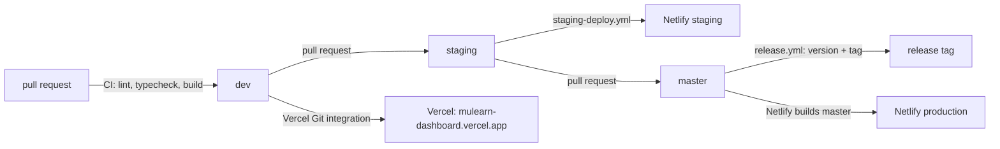

# Build and deployment

How the dashboard is built, configured and promoted. Facts describe `dev` at 6d6cb30b; the environments were checked against GitHub's deployment records, environments and settings on 23 Nov 2026 (issue 0041). The decision is [ADR-013](adr/ADR-013-build-and-deploy.md); the hands-on guide for maintainers is `docs/DEPLOYMENT.md`.

## Environments

| Environment | Branch | Where | How it deploys at 6d6cb30b |
|---|---|---|---|
| Development | `dev` | Vercel project `mulearn-dashboard` (scope `awindsrs-projects`), `https://mulearn-dashboard.vercel.app` | Vercel's Git integration, not a workflow. Every push to `dev` is a deployment Vercel labels **Production** (GitHub shows them under the `Production` environment). Other branches and pull requests get **Preview** deployments |
| Staging | `staging` | Netlify, `staging.app.mulearn.org` | `.github/workflows/staging-deploy.yml`: lint, typecheck, then deploy from the Actions runner |
| Production | `master` | Netlify, `app.mulearn.org` | Netlify's own builders, from its Git integration: no workflow deploys production. `netlify.toml` and `scripts/netlify-ignore.sh` let Netlify build only `master` and CI-driven deploys. The GitHub `Production` environment has a `NETLIFY_PRODUCTION_SITE_ID` secret and variables, but no workflow uses them |

Promotion goes `dev` → `staging` → `master`, each step through a pull request. `release.yml` versions and tags `master` with changesets, and `changeset-check.yml` requires a changeset on pull requests to `dev` and `staging`.

## Configuration

- **Build-time variables** are every `NEXT_PUBLIC_*` value, checked by `config/env.ts`. They are baked into the build, so changing one means rebuilding that environment.
  - **Staging** reads them from the `staging` GitHub environment, but only the ones `staging-deploy.yml` forwards in its build step's `env:` block: today `NEXT_PUBLIC_DJANGO_API_URL` and `NEXT_PUBLIC_DISCORD_AUTH_URL`. A new variable must be added there too. A value set only in Netlify's UI is missing from that build.
  - **Production:** Netlify builds `master` on its own builders, so the build reads them from the **production Netlify site's environment variables**, not from GitHub.
  - **Development:** the Vercel project's environment variables, in its **Production** scope (that is `dev`'s deployment). Pull request previews read the **Preview** scope.
  - **Pull request CI** (`ci.yml`) only checks that the app builds. It reads the repository-level variables `NEXT_PUBLIC_DJANGO_API_URL` and `NEXT_PUBLIC_DISCORD_AUTH_URL`.
- **Runtime variables** come from the Netlify site, and are read by server code on each request: `BACKEND_URL`, the backend address for server-side calls.
- **Today's variables** (`config/env.ts`) are `NEXT_PUBLIC_DJANGO_API_URL` (the API host the browser calls), `NEXT_PUBLIC_DISCORD_AUTH_URL`, and the optional `BACKEND_URL`.
- **`next.config.ts` adds** `NEXT_PUBLIC_APP_VERSION` (from `package.json`) and `NEXT_PUBLIC_BUILD_SHA` (from the build's commit).
- **Feature flags for new sends** are build-time variables named `NEXT_PUBLIC_FEATURE_<NAME>`. Each is added to `config/env.ts` as an optional boolean that is off unless set, and is turned on per environment by a maintainer: set in that environment and, for staging, forwarded in `staging-deploy.yml` ([ADR-011](adr/ADR-011-flags-for-new-sends.md)).

## Releases and the backend

The dashboard and the backend deploy separately, so a release must never turn on something the backend in that environment doesn't support:
1. **Every flag that is on** in an environment has its backend capability deployed there.
2. **The maintainer turning a flag on** records the backend change and the environment in the rollout issue.
3. **Reading new optional fields needs nothing** ([06-backend-contract.md](06-backend-contract.md)).

## Where a new build-time variable goes

A new `NEXT_PUBLIC_*` value is baked in at build time, so it must be set wherever each environment builds, and that environment rebuilt:

| Environment | Set it in | Notes |
|---|---|---|
| Development (`dev`) | the Vercel project `mulearn-dashboard` → Settings → Environment Variables, **Production** scope; **Preview** too for pull request previews | Vercel rebuilds on the next push to `dev`. |
| Pull request CI | repository variables (Settings → Secrets and variables → Actions → Variables), and the `env:` of `ci.yml`'s build step | Only needed when the build fails without it. |
| Staging | the `staging` GitHub environment's variables, **and** the `env:` block of the deploy step in `staging-deploy.yml` | The workflow forwards only the values it names. |
| Production | the production Netlify site → Site configuration → Environment variables | Netlify builds `master` itself. The GitHub `Production` environment's variables aren't read by any build today. |

Runtime-only values such as `BACKEND_URL` go in each Netlify site's environment variables, and in the Vercel project for `dev`. A GitHub environment can't pass them to the deployed server.

## What was checked (issue 0041, 23 Nov 2026)

- **Deployment records.** All 100 recent GitHub deployments are from `vercel[bot]` (`Preview`, and `Production` for `dev` commits such as 9e50816c and 6d6cb30b) or the staging workflow (`staging`). None are production Netlify deploys: Netlify's Git integration doesn't record GitHub deployments.
- **GitHub environments** and what they hold (names only):

  | Environment | Secrets | Variables | Used by |
  |---|---|---|---|
  | `staging` | `NETLIFY_STAGING_SITE_ID` | `NEXT_PUBLIC_DJANGO_API_URL`, `NEXT_PUBLIC_DISCORD_AUTH_URL`, `NEXT_PUBLIC_CDN_URL`, `BACKEND_URL` | `staging-deploy.yml`, which forwards only the first two |
  | `Production` | `NETLIFY_PRODUCTION_SITE_ID` | `NEXT_PUBLIC_DJANGO_API_URL`, `NEXT_PUBLIC_DISCORD_AUTH_URL`, `BACKEND_URL` | no workflow. Vercel also records `dev`'s deployments under this name |
  | `Preview` | none | none | Vercel's pull request previews |
  | `Production – mulearn-dashboard`, `Production – mulearn-dashboard-pq2w`, and their `Preview –` pairs | none | none | older Vercel projects; the last deployment was in February 2026 |
  | `copilot` | none | none | GitHub Copilot's agent |

- **Repository level:** secrets `NETLIFY_AUTH_TOKEN`, `DOCS_REPO_TOKEN` and `ADD_TO_PROJECT_TOKEN`; variables `NEXT_PUBLIC_DJANGO_API_URL` and `NEXT_PUBLIC_DISCORD_AUTH_URL`.
- **Differences from `docs/DEPLOYMENT.md`:**
  - the guide expects an environment named `production`, but it is `Production`;
  - it expects Actions-driven production deploys, which don't exist;
  - `NEXT_PUBLIC_CDN_URL` is set for staging but read nowhere in the code;
  - `BACKEND_URL` in the GitHub environments has no effect, because it is read at runtime from the Netlify site.
- **`release.yml` failed** on `master` on 11 Nov 2026. It cloned the changelog repository into `docs/`, which this repository already has. Fixed alongside this page: it now clones into `$RUNNER_TEMP`.

## Still to confirm

Only the Netlify and Vercel dashboards can show these, and the repository can't. Owner: @awindsr, who has access to both.
- That the Netlify site serving `app.mulearn.org` has its Git integration on, builds only `master`, and has branch deploys and build hooks off (`docs/DEPLOYMENT.md`, Step 2). The repository is linked to a Netlify site named `mulearn-dashboard-new`, which posts deploy-preview statuses.
- That the Vercel project's **Production** branch is `dev`.
- Whether the older Vercel projects (`mulearn-dashboard-pq2w` and the earlier `mulearn-dashboard` environments) can be removed.
