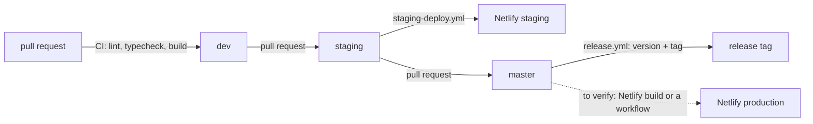

# Build and deployment

How the dashboard is built, configured and promoted, and what's still to verify. Facts describe `dev` at 6d6cb30b. The decision is [ADR-013](adr/ADR-013-build-and-deploy.md); the hands-on guide for maintainers is `docs/DEPLOYMENT.md`.

## Environments

| Environment | Branch | Where | How it deploys at 6d6cb30b |
|---|---|---|---|
| Development | `dev` | not recorded in the repository | **To verify** (issue 0041): no workflow or config in the repo deploys `dev` |
| Staging | `staging` | Netlify, `staging.app.mulearn.org` | `.github/workflows/staging-deploy.yml`: lint, typecheck, then deploy from the Actions runner |
| Production | `master` | Netlify, `app.mulearn.org` | **To verify** (issue 0041): no workflow deploys production. `netlify.toml` lets Netlify build `master` on its own builders as a backstop (`scripts/netlify-ignore.sh`), while `docs/DEPLOYMENT.md` describes Actions-driven deploys |

Promotion goes `dev` → `staging` → `master`, each step through a pull request. `release.yml` versions and tags `master` with changesets, and `changeset-check.yml` requires a changeset on pull requests to `dev` and `staging`.

## Configuration

- **Build-time variables** are every `NEXT_PUBLIC_*` value, checked by `config/env.ts`. They are baked into the build, so changing one means rebuilding that environment.
  - **Staging** reads them from the `staging` GitHub environment, but only the ones `staging-deploy.yml` forwards in its build step's `env:` block: today `NEXT_PUBLIC_DJANGO_API_URL` and `NEXT_PUBLIC_DISCORD_AUTH_URL`. A new variable must be added there too. A value set only in Netlify's UI is missing from that build.
  - **Production:** where its build gets them is to verify (issue 0041).
- **Runtime variables** come from the Netlify site, and are read by server code on each request: `BACKEND_URL`, the backend address for server-side calls.
- **Today's variables** (`config/env.ts`) are `NEXT_PUBLIC_DJANGO_API_URL` (the API host the browser calls), `NEXT_PUBLIC_DISCORD_AUTH_URL`, and the optional `BACKEND_URL`.
- **`next.config.ts` adds** `NEXT_PUBLIC_APP_VERSION` (from `package.json`) and `NEXT_PUBLIC_BUILD_SHA` (from the build's commit).
- **Feature flags for new sends** are build-time variables named `NEXT_PUBLIC_FEATURE_<NAME>`. Each is added to `config/env.ts` as an optional boolean that is off unless set, and is turned on per environment by a maintainer: set in that environment and, for staging, forwarded in `staging-deploy.yml` ([ADR-011](adr/ADR-011-flags-for-new-sends.md)).

## Releases and the backend

The dashboard and the backend deploy separately, so a release must never turn on something the backend in that environment doesn't support:
1. **Every flag that is on** in an environment has its backend capability deployed there.
2. **The maintainer turning a flag on** records the backend change and the environment in the rollout issue.
3. **Reading new optional fields needs nothing** ([06-backend-contract.md](06-backend-contract.md)).

## To verify

These are open questions for the maintainers; issue 0041 records the answers. The docs don't guess:
- How `dev` is deployed, and where.
- Which path production uses today: Netlify building `master`, or a workflow kept outside the repo.
- Which GitHub environments and secrets exist (`docs/DEPLOYMENT.md` lists the expected ones).
