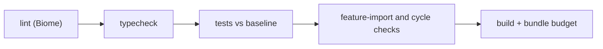

# Testing and quality gates

How the dashboard is tested, what CI checks, and how known failures are handled without blocking work. Facts describe `dev` at 6d6cb30b. The decision is [ADR-012](adr/ADR-012-tests-in-ci-with-a-baseline.md).

## Today

- **Tests.** 115 test files (`*.test.ts` and `*.test.tsx`) use Vitest with jsdom and Testing Library (`vitest.config.ts`, setup in `src/test-setup.ts`). There is no `test` script in `package.json`, and CI doesn't run the tests. Some of them fail today.
- **CI** (`.github/workflows/ci.yml`) runs `bun run lint` (Biome), `bun run typecheck` and `bun run build`.
- **Import cycles** can be listed with `bun run lint:circular` (madge), but CI doesn't run it.

## Running tests

The tests don't touch a database, so they're safe to run locally.

**Until the `test` script lands** (issue 0001), run:

```sh
bunx vitest run <paths>
```

**After it lands**, run:

```sh
bun run test <paths>
```

Lint, types and build are checked with:

```sh
bun run lint
bun run typecheck
bun run build
```

Never point a test at staging or production with real credentials. The staging smoke suite is run by maintainers only.

## Kinds of tests

| Kind | Where | Example |
|---|---|---|
| Unit | next to the code, `*.test.ts` | `parseApiError` returns `code` and `requestId` when the envelope has them, and works without them |
| Component | next to the component, `*.test.tsx`, with Testing Library | the events list shows `SectionErrorFallback` with a retry when its query fails |
| Hook | in the feature's `hooks/` | a mutation invalidates `eventKeys.detail(id)` and nothing broader |
| Contract | `src/features/<name>/api/*.test.ts` | the zod schema accepts a recorded backend response, and also accepts it with `code` and `requestId` added |
| Access | `src/lib/auth/*.test.ts` | a user holding two roles opens a page either role allows (the union rule) |
| Smoke (maintainers, staging) | a small suite run against staging | sign in, open the dashboard home, open one page per core module, sign out |

**Recorded responses** for contract tests are saved backend envelopes with personal data replaced. They are never copied from production.

## The failure baseline

- **The baseline is a list of today's failing tests,** kept in a new `scripts/allowlists/test-baseline.txt`, added with the `test` script.
- **A CI job runs the whole suite.** A failure that isn't on the list fails the build.
- **A listed test that now passes** fails the check too, and is printed, so it's removed from the list in the same pull request.
- **The list only shrinks.** Adding a test to it needs a reviewer to agree, with the reason in the pull request.

## CI pipeline (target)



| Check | Fails when |
|---|---|
| Lint | Biome reports an error |
| Typecheck | `tsc --noEmit` fails |
| Tests | a test fails that isn't on the baseline, or the baseline lists a test that now passes |
| Feature imports | a new import reaches into another feature's internals, or a listed one is gone |
| Import cycles | a new cycle appears, or a listed one is gone |
| Build | `next build` fails |
| Bundle budget | a route loads more JavaScript than its budget |

## Line endings

There is no `.gitattributes`, so files checked out on Windows can get CRLF line endings, and lint then reports errors that don't appear elsewhere. A `.gitattributes` file sets LF for text files, so lint gives the same result on every system.

## Reviews

- **One approving review** is enough, except for `core-review` issues (auth and tokens, page access, payments, deploy or release configuration), which need two.
- **Every pull request pastes its test output** and ticks its issue's acceptance criteria.
