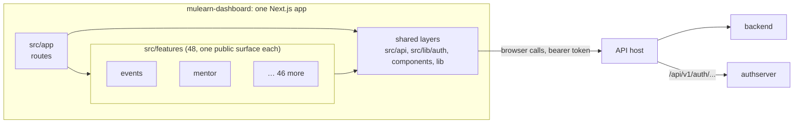

# μLearn dashboard architecture

This folder is the architecture of `mulearn-dashboard`:
- how it works today;
- the shape it is moving to (**one app with strict feature modules**);
- the rules every contributor follows;
- how the dashboard follows the backend's changes;
- the first 12 weeks of work, split into issues anyone can pick up.

The current-state pages describe `dev` at 6d6cb30b (17 Nov 2026). The target pages describe where the code is going: nothing in them exists yet unless a page says so. The backend has its own architecture folder ([backend architecture](https://github.com/gtech-mulearn/mulearnbackend/blob/dev/docs/architecture/README.md)), and the two share phase names and a calendar.

## The shape in one picture

## Reading order

| You are | Start with | Then |
|---|---|---|
| A first-time contributor | The issue you picked in [github-issues/](github-issues/README.md) | The pages its "Before you start" links |
| A regular contributor | [04-module-rules.md](04-module-rules.md) | Your module's page in [modules/](modules/README.md); [16-contributing-to-the-architecture.md](16-contributing-to-the-architecture.md) |
| A reviewer or maintainer | [04-module-rules.md](04-module-rules.md) | [adr/](adr/README.md), [13-migration-strategy.md](13-migration-strategy.md), [12-testing-and-quality-gates.md](12-testing-and-quality-gates.md) |
| A backend contributor | [06-backend-contract.md](06-backend-contract.md) and its change tracker | [08-auth-and-access.md](08-auth-and-access.md) |
| Leadership | [01-overview.md](01-overview.md) | [14-roadmap.md](14-roadmap.md), [15-risks-and-future-scale.md](15-risks-and-future-scale.md) |

## Pages

| Page | What it covers |
|---|---|
| [01-overview.md](01-overview.md) | Summary, the system, principles, the options compared, recommendations |
| [02-current-state.md](02-current-state.md) | How the dashboard works today: code, requests, auth, state, CI, findings |
| [03-target-architecture.md](03-target-architecture.md) | The shape, modules, what talks to what, the rules, today and the target |
| [04-module-rules.md](04-module-rules.md) | Feature anatomy, import rules, where code goes, how CI enforces each rule |
| [05-data-fetching-and-state.md](05-data-fetching-and-state.md) | TanStack Query, keys, parsing, paging, server data, UI state |
| [06-backend-contract.md](06-backend-contract.md) | The envelope, request rules, the coming limits, the change tracker |
| [07-ui-and-design-system.md](07-ui-and-design-system.md) | Components, the design system, the accessibility baseline |
| [08-auth-and-access.md](08-auth-and-access.md) | Sign-in, tokens, refresh, page access, anonymous calls |
| [09-performance.md](09-performance.md) | Targets, rules, bundle budgets |
| [10-build-and-deployment.md](10-build-and-deployment.md) | Environments, configuration, releases, what's still to verify |
| [11-reliability-and-observability.md](11-reliability-and-observability.md) | Behaviour when the backend fails, error boundaries, error reporting |
| [12-testing-and-quality-gates.md](12-testing-and-quality-gates.md) | Running tests, kinds of tests, the failure baseline, CI |
| [13-migration-strategy.md](13-migration-strategy.md) | The migration rules, one feature at a time, how each phase follows the backend |
| [14-roadmap.md](14-roadmap.md) | The first 12 weeks, week by week |
| [15-risks-and-future-scale.md](15-risks-and-future-scale.md) | Failure modes and the triggers for revisiting the shape |
| [16-contributing-to-the-architecture.md](16-contributing-to-the-architecture.md) | Golden paths, decisions, reviews |
| [modules/](modules/README.md) | One page per module |
| [adr/](adr/README.md) | The architecture decision records |
| [github-issues/](github-issues/README.md) | The work, as issues |

## Keeping this folder true

- **Update the docs in the same change.** When a pull request changes something these pages describe, update the page in the same pull request.
- **When the backend changes something the dashboard can observe,** add its row to the [change tracker](06-backend-contract.md#the-change-tracker).
- **Code and docs disagree?** The automated checks are the rule. Fix the page.
- **A rule changes only through an ADR** ([adr/README.md](adr/README.md)).
