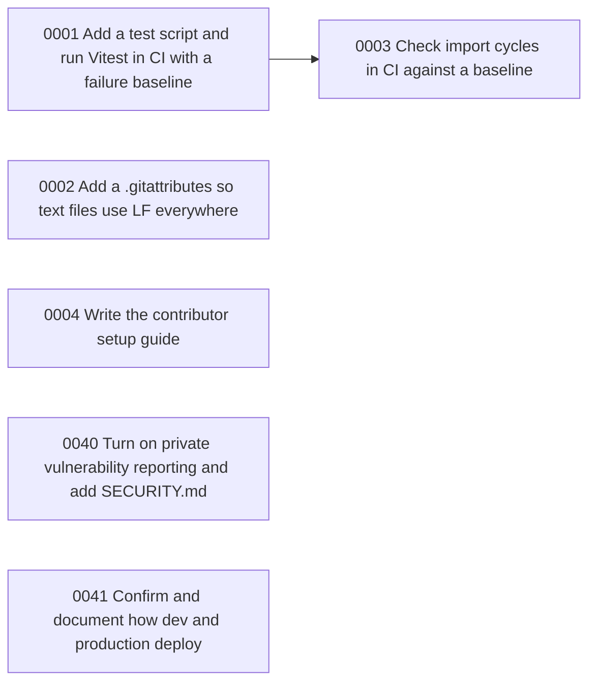
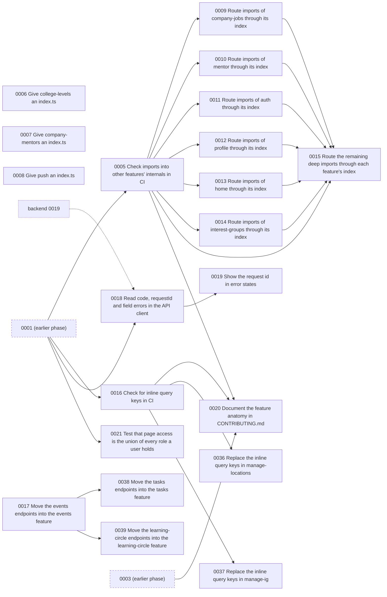
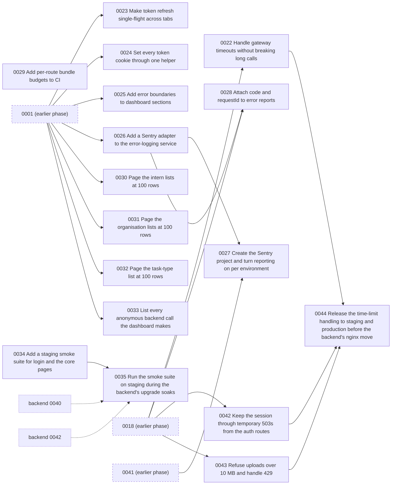

# Dashboard issues

The work in [the dashboard architecture](../README.md), split into issues anyone can pick up. Each file here becomes one GitHub issue when the maintainers file it. Each issue is one pull request.

## How to pick an issue

1. **Find an open issue whose dependencies have all merged.** The header table of each issue lists them. "Depends on" holds dashboard issues; "Backend" holds backend issues (see below). The dependency graph for each phase is below.
2. **Read "Before you start".** It links the pages you need, and nothing else is assumed.
3. **Comment on the GitHub issue to claim it,** so two people don't work on the same thing. If you stop, say so, so someone else can pick it up.
4. **Work on a branch from `dev`,** and open one pull request into `dev` that does exactly what the issue says. Anything under "Out of scope" goes in a separate issue.
5. **Check every acceptance criterion,** and paste the test output in the pull request.
6. **Add a changeset to every pull request;** CI checks for one. For a chore or docs change, add an empty one with `bunx changeset --empty`.
7. **Know the review rules.** Issues labelled `core-review` need two approvals, one of them from a maintainer. `maintainer-only` issues need access only maintainers have, such as production settings or a service account. They are listed so you can see the whole plan.

New here? Start with an issue labelled `good first issue`.

## Setting up a fresh clone

1. Install Node 22 or later and Bun 1.3.
2. **On Windows,** run `git config --global core.autocrlf false` before cloning, so files keep LF line endings and `bun run lint` passes. Once issue 0002 lands, `.gitattributes` does this for you; an existing clone then needs a fresh checkout.
3. Run `bun install`.
4. Copy `.env.example` to `.env.local` and set both required values. `config/env.ts` refuses to start or build without them:
   - `NEXT_PUBLIC_DJANGO_API_URL`: a backend you're allowed to use, for example `http://localhost:8000` for one running locally. Never use production credentials.
   - `NEXT_PUBLIC_DISCORD_AUTH_URL`: any valid URL works for local work, for example `http://localhost:3000`.
5. Run `bun dev`, and open `http://localhost:3000`. `bun run build` also works with these values.

## Test commands

The tests don't touch a database, so they're safe to run locally.

- **Until issue 0001 lands:** `bunx vitest run <paths>`. Some tests fail today; until 0001 lists them, compare against a run on `dev` before your change.
- **After it lands:** `bun run test <paths>`.
- **Always also run** `bun run lint`, `bun run typecheck` and, before asking for review, `bun run build`.

No issue asks you to run anything against staging or production. The staging smoke suite is run by maintainers.

### Rules for the check scripts

Several issues add a check script under `scripts/` with a shrink-only list in `scripts/allowlists/`. They all follow the same rules:
- **Node APIs only.** `tsconfig.json` type-checks `scripts/`, and `@types/bun` isn't installed. Run them with `bun scripts/<name>.ts`.
- **Print with `console.error`.** The pre-commit hook refuses staged `console.log`.
- **Paths use `/`, and files use LF,** so the lists are the same on Windows and Linux.
- **List files** start with `#` comment lines, then one entry per line, sorted in plain code-unit order (JavaScript's default `sort()`). The check fails on an unsorted list.
- **`--update` rewrites the list** from the current code. Use it only to remove entries you fixed, never to add new ones.
- **A missing or unreadable input fails the check.**
- **Evidence.** Where an acceptance criterion says "on a throwaway branch", pasting the local output of the failing check is enough.

## Backend

Some issues follow a change in the backend. The backend's plan is in its own repository ([backend architecture](https://github.com/gtech-mulearn/mulearnbackend/blob/dev/docs/architecture/README.md)), and the [change tracker](../06-backend-contract.md#the-change-tracker) lists every backend change the dashboard can observe.

- **The "Backend" row** in an issue's header lists the backend issues it waits for. They must be merged on the backend's `dev` before you start; the issue's "Before you start" says so too. Those issues carry the `needs-backend` label.
- **Reading new optional fields needs no gate.** The dashboard works whether or not the backend sends them.
- **Sending anything new is gated.** A change that sends a new field or header goes behind its own `NEXT_PUBLIC_FEATURE_<NAME>` flag, off by default. A `maintainer-only` rollout issue turns the flag on per environment once that environment's backend accepts it ([ADR-011](../adr/ADR-011-flags-for-new-sends.md)). The 12-week plan has no such change.
- **Rollout issues** that wait for a backend deploy have no week on the roadmap. Backend weeks are merge weeks, and deploys follow the backend's release trains.

## Labels

| Label | Meaning |
|---|---|
| `arch` | Part of the architecture programme |
| `phase:N` | Which phase it belongs to (the phases share the backend's names) |
| `module:<name>` | Which module it belongs to ([modules/](../modules/README.md)), or `platform` for repo-wide work |
| `size:S` / `size:M` / `size:L` | About half a day, one day or two days for someone new to the repository |
| `type:feature` / `type:chore` / `type:docs` / `type:epic` | The kind of work |
| `good first issue` | Size S, no dependencies, no backend dependency, not on an auth, token or release path |
| `needs-backend` | Waits for a backend issue (see "Backend" above) |
| `core-review` | Auth and tokens, page access, payments, or deploy and release configuration: needs two approvals, one from a maintainer |
| `maintainer-only` | Needs production settings, a service account or other maintainer access |
| `status:blocked` | A dependency hasn't merged |

## Reporting a vulnerability

Never open a public issue or pull request for a security problem. Report it privately, through the repository's private vulnerability reporting, as [SECURITY.md](../../../SECURITY.md) explains.

## Phases and milestones

The phases use the backend's names, so a dashboard issue can sit in the same phase as the backend work it follows. The weeks are indicative: anyone may pick up an issue, so the pace isn't known. Week 1 starts on Thu 10 Dec 2026, as in the backend's plan.

| Phase | Milestone | Weeks (indicative) | Issues |
|---|---|---|---|
| 0 | Phase 0: Stabilise and secure | 1–2 | 6 |
| 1 | Phase 1: Foundations | 1–9 | 21 |
| 2 | Phase 2: Serving and runtime | 3–7 | 17 |
| 3 | Phase 3: Schema safety net and events | — | none needed (see the change tracker) |
| 4 | Phase 4: Contributions and the ledger | — | none needed (see the change tracker) |
| 5 | Phase 5: Identity and access | after week 12 | epic |
| 6 | Phase 6: Gamification and notifications | after week 12 | epic |
| 7 | Phase 7: People and privacy | after week 12 | epic |
| 8 | Phase 8: API standards and rewards | after week 12 | epic |
| later | Later: on demand | when triggered | epic |

## Work already in flight

These are in progress, not landed and not absent. No issue here duplicates them.

| Work | What it covers |
|---|---|
| mulearn-dashboard #547 | Team notifications: access, activity log, push copy versions (to `dev`) |
| mulearn-dashboard #546 | A mentor's company is never treated as their college (to `staging`) |
| The design-system work | A design system on its own branch; screen changes wait for the maintainers' approval |
| Per-module notes for automated contributors | Notes in a new `docs/agents/` folder, not yet in `dev`; module pages will link them once they land |

## Phase 0: Stabilise and secure

Make the repository safe to change: tests run in CI with a baseline of today's failures, line endings are the same on every system, import cycles stop growing, and a newcomer can set up a clone from one guide. Maintainers switch on private vulnerability reporting and confirm how dev and production deploy.

| ID | Title | Phase | Module | Size | Depends on | Labels |
|---|---|---|---|---|---|---|
| [0001](0001-test-script-and-ci-baseline.md) | Add a test script and run Vitest in CI with a failure baseline | 0 | platform | M | none | arch, phase:0, module:platform, type:chore, size:M |
| [0002](0002-gitattributes-line-endings.md) | Add a .gitattributes so text files use LF everywhere | 0 | platform | S | none | arch, phase:0, module:platform, type:chore, size:S, good first issue |
| [0003](0003-import-cycle-check.md) | Check import cycles in CI against a baseline | 0 | platform | S | 0001 | arch, phase:0, module:platform, type:chore, size:S |
| [0004](0004-contributor-setup-guide.md) | Write the contributor setup guide | 0 | platform | S | none | arch, phase:0, module:platform, type:docs, size:S, good first issue |
| [0040](0040-private-vulnerability-reporting.md) | Turn on private vulnerability reporting and add SECURITY.md | 0 | platform | S | none | arch, phase:0, module:platform, type:chore, size:S, maintainer-only |
| [0041](0041-confirm-deploy-paths.md) | Confirm and document how dev and production deploy | 0 | platform | S | none | arch, phase:0, module:platform, type:docs, size:S, maintainer-only |

## Phase 1: Foundations

Put the module rules in place: a CI check for imports into other features' internals, every feature with an `index.ts`, the most-imported features routed through their public surface, a CI check against inline query keys, per-feature endpoints as a pattern, the API client ready for the backend's `code` and `requestId`, and the multi-role rule under test.

| ID | Title | Phase | Module | Size | Depends on | Labels |
|---|---|---|---|---|---|---|
| [0005](0005-feature-import-check.md) | Check imports into other features' internals in CI | 1 | platform | M | 0001 | arch, phase:1, module:platform, type:chore, size:M |
| [0006](0006-index-college-levels.md) | Give college-levels an index.ts | 1 | organizations | S | none | arch, phase:1, module:organizations, type:chore, size:S, good first issue |
| [0007](0007-index-company-mentors.md) | Give company-mentors an index.ts | 1 | mentorship | S | none | arch, phase:1, module:mentorship, type:chore, size:S, good first issue |
| [0008](0008-index-push.md) | Give push an index.ts | 1 | notifications | S | none | arch, phase:1, module:notifications, type:chore, size:S, good first issue |
| [0009](0009-company-jobs-public-surface.md) | Route imports of company-jobs through its index | 1 | careers | L | 0005 | arch, phase:1, module:careers, type:chore, size:L |
| [0010](0010-mentor-public-surface.md) | Route imports of mentor through its index | 1 | mentorship | M | 0005 | arch, phase:1, module:mentorship, type:chore, size:M |
| [0011](0011-auth-public-surface.md) | Route imports of auth through its index | 1 | auth-and-access | M | 0005 | arch, phase:1, module:auth-and-access, type:chore, size:M, core-review |
| [0012](0012-profile-public-surface.md) | Route imports of profile through its index | 1 | people | S | 0005 | arch, phase:1, module:people, type:chore, size:S |
| [0013](0013-home-public-surface.md) | Route imports of home through its index | 1 | workspace | S | 0005 | arch, phase:1, module:workspace, type:chore, size:S |
| [0014](0014-interest-groups-public-surface.md) | Route imports of interest-groups through its index | 1 | communities | S | 0005 | arch, phase:1, module:communities, type:chore, size:S |
| [0015](0015-remaining-deep-imports.md) | Route the remaining deep imports through each feature's index | 1 | platform | L | 0005, 0009, 0010, 0011, 0012, 0013, 0014 | arch, phase:1, module:platform, type:chore, size:L |
| [0016](0016-inline-query-key-check.md) | Check for inline query keys in CI | 1 | platform | M | 0001 | arch, phase:1, module:platform, type:chore, size:M |
| [0017](0017-events-endpoints-in-feature.md) | Move the events endpoints into the events feature | 1 | events | S | none | arch, phase:1, module:events, type:chore, size:S, good first issue |
| [0018](0018-api-error-model.md) | Read `code`, `requestId` and field errors in the API client | 1 | api-client | M | 0001 | arch, phase:1, module:api-client, type:feature, size:M, needs-backend |
| [0019](0019-request-id-in-error-states.md) | Show the request id in error states | 1 | app-shell | M | 0018 | arch, phase:1, module:app-shell, type:feature, size:M |
| [0020](0020-feature-anatomy-in-contributing.md) | Document the feature anatomy in CONTRIBUTING.md | 1 | platform | S | 0003, 0005, 0016 | arch, phase:1, module:platform, type:docs, size:S |
| [0021](0021-multi-role-union-tests.md) | Test that page access is the union of every role a user holds | 1 | auth-and-access | S | 0001 | arch, phase:1, module:auth-and-access, type:chore, size:S, core-review |
| [0036](0036-query-keys-manage-locations.md) | Replace the inline query keys in manage-locations | 1 | organizations | S | 0016 | arch, phase:1, module:organizations, type:chore, size:S |
| [0037](0037-query-keys-manage-ig.md) | Replace the inline query keys in manage-ig | 1 | communities | S | 0016 | arch, phase:1, module:communities, type:chore, size:S |
| [0038](0038-tasks-endpoints-in-feature.md) | Move the tasks endpoints into the tasks feature | 1 | learning | S | 0017 | arch, phase:1, module:learning, type:chore, size:S |
| [0039](0039-learning-circle-endpoints-in-feature.md) | Move the learning-circle endpoints into the learning-circle feature | 1 | communities | S | 0017 | arch, phase:1, module:communities, type:chore, size:S |

## Phase 2: Serving and runtime

Get ready for the backend's move behind nginx and for its later page caps: handle time limits without breaking long calls, keep the session through temporary 503s, refuse oversized uploads and handle 429, and release all of it before the backend's move; contain failures with error boundaries; report errors with request ids; keep bundles within budget; refresh tokens once across tabs; page every list at 100 rows; list the anonymous calls the backend must keep public; and give maintainers a staging smoke suite.

| ID | Title | Phase | Module | Size | Depends on | Labels |
|---|---|---|---|---|---|---|
| [0022](0022-gateway-timeouts.md) | Handle gateway timeouts without breaking long calls | 2 | api-client | M | 0018 | arch, phase:2, module:api-client, type:feature, size:M, core-review |
| [0023](0023-single-flight-refresh.md) | Make token refresh single-flight across tabs | 2 | auth-and-access | M | 0001 | arch, phase:2, module:auth-and-access, type:feature, size:M, core-review |
| [0024](0024-one-token-cookie-helper.md) | Set every token cookie through one helper | 2 | auth-and-access | M | 0001 | arch, phase:2, module:auth-and-access, type:chore, size:M, core-review |
| [0025](0025-error-boundaries.md) | Add error boundaries to dashboard sections | 2 | app-shell | M | 0001 | arch, phase:2, module:app-shell, type:feature, size:M |
| [0026](0026-sentry-adapter.md) | Add a Sentry adapter to the error-logging service | 2 | shared-lib | M | 0001 | arch, phase:2, module:shared-lib, type:feature, size:M |
| [0027](0027-rollout-sentry.md) | Create the Sentry project and turn reporting on per environment | 2 | platform | S | 0026, 0041 | arch, phase:2, module:platform, type:chore, size:S, maintainer-only |
| [0028](0028-report-request-ids.md) | Attach `code` and `requestId` to error reports | 2 | api-client | S | 0018, 0026 | arch, phase:2, module:api-client, type:feature, size:S |
| [0029](0029-bundle-budgets.md) | Add per-route bundle budgets to CI | 2 | platform | M | none | arch, phase:2, module:platform, type:chore, size:M |
| [0030](0030-page-intern-lists.md) | Page the intern lists at 100 rows | 2 | interns | L | 0001 | arch, phase:2, module:interns, type:chore, size:L |
| [0031](0031-page-organisation-lists.md) | Page the organisation lists at 100 rows | 2 | organizations | S | 0001 | arch, phase:2, module:organizations, type:chore, size:S |
| [0032](0032-page-task-type-list.md) | Page the task-type list at 100 rows | 2 | learning | S | 0001 | arch, phase:2, module:learning, type:chore, size:S |
| [0033](0033-anonymous-calls-list.md) | List every anonymous backend call the dashboard makes | 2 | api-client | M | 0001 | arch, phase:2, module:api-client, type:chore, size:M, core-review |
| [0034](0034-staging-smoke-suite.md) | Add a staging smoke suite for login and the core pages | 2 | platform | M | none | arch, phase:2, module:platform, type:chore, size:M |
| [0035](0035-rollout-smoke-during-soaks.md) | Run the smoke suite on staging during the backend's upgrade soaks | 2 | platform | S | 0034 | arch, phase:2, module:platform, type:chore, size:S, needs-backend, maintainer-only |
| [0042](0042-auth-503-keeps-session.md) | Keep the session through temporary 503s from the auth routes | 2 | auth-and-access | M | 0018 | arch, phase:2, module:auth-and-access, type:feature, size:M, core-review |
| [0043](0043-upload-limit-and-429.md) | Refuse uploads over 10 MB and handle 429 | 2 | api-client | M | 0018 | arch, phase:2, module:api-client, type:feature, size:M |
| [0044](0044-release-before-nginx.md) | Release the time-limit handling to staging and production before the backend's nginx move | 2 | platform | S | 0022, 0042, 0043 | arch, phase:2, module:platform, type:chore, size:S, maintainer-only |

## Epics

Later phases are epics. Each is split into detailed issues when its phase comes within reach, or when its entry condition is met.

| Epic | Title | Phase |
|---|---|---|
| [security-hardening](epics/security-hardening.md) | Security hardening, tracked privately by the maintainers | 0 |
| [phase-5-identity-and-access](epics/phase-5-identity-and-access.md) | Phase 5: page access from the backend's grants | 5 |
| [phase-6-gamification-and-notifications](epics/phase-6-gamification-and-notifications.md) | Phase 6: gamification and notifications | 6 |
| [phase-7-people-and-privacy](epics/phase-7-people-and-privacy.md) | Phase 7: people and privacy | 7 |
| [phase-8-api-standards-and-rewards](epics/phase-8-api-standards-and-rewards.md) | Phase 8: API standards and rewards | 8 |
| [design-system-adoption](epics/design-system-adoption.md) | Adopt the design system | later |
| [later-on-demand](epics/later-on-demand.md) | Later: edge verification and token storage | later |
